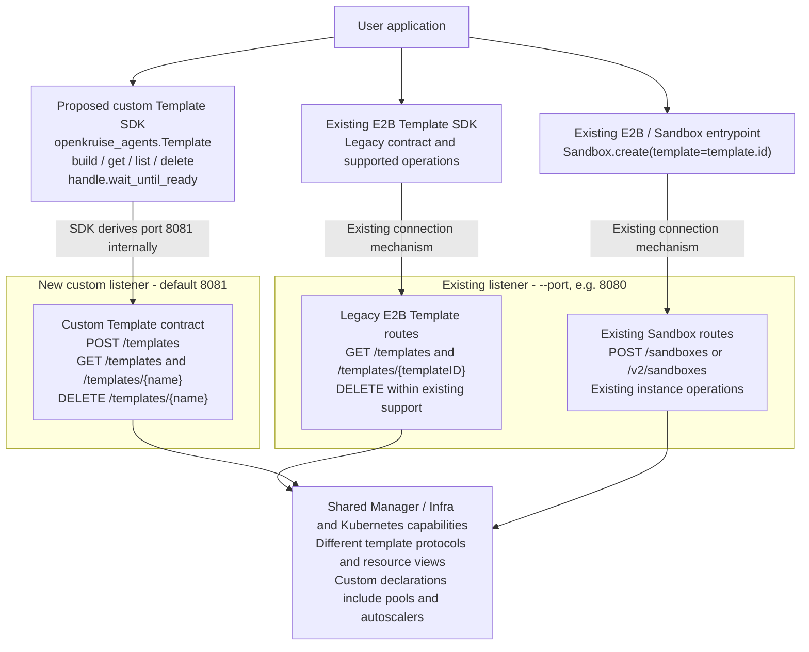
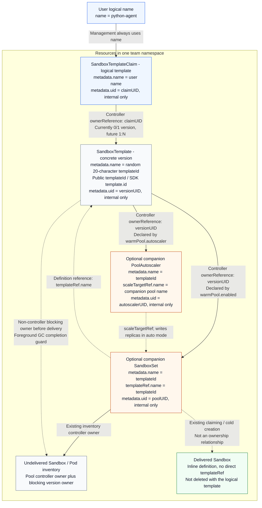

# Custom Template API and Companion Warm Pools

> **Proposal; the complete first release is not released.** Local P0-P5 work now includes the resource types, neutral rules, independent control cache, Manager/custom HTTP API, definition controllers, fixed pools, and durable deletion path. Autoscaler orchestration, the target SDK, and deployment/cluster acceptance remain P6-P8 work. Authors and reviewers will be assigned during review; local implementation does not imply release or complete production acceptance.
>
> This is an additive custom API, not a rewrite of the existing E2B Template proposal. Checkpoint builds, command DSLs, additional backends, and the earlier identity model are outside this release. The contracts below are self-contained; implementation plans, Chinese review material, and readiness logs are maintained separately from this repository's proposal.

## Table of Contents

- [Glossary](#glossary)
- [Summary](#summary)
- [Motivation](#motivation)
- [Proposal](#proposal)
  - [User Stories and Integration](#user-stories)
  - [Identity and Resource Model](#resource-model)
  - [Interface Design](#interface-design)
  - [Creation and Partial Failure](#creation)
  - [Definition Validation and State Machine](#validation)
  - [Companion Warm Pools and Autoscaling](#companions)
  - [Inheritance and Sandbox Consumption](#consumption)
  - [Synchronous Deletion and Concurrency](#deletion)
  - [Read Consistency and Control Cache](#consistency)
- [Implementation Details](#implementation)
- [Security, Risks, and Mitigations](#risks)
- [Alternatives](#alternatives)
- [Upgrade Strategy](#upgrade)
- [Test Plan](#test-plan)
- [Implementation History](#history)
- [References](#references)

<a id="glossary"></a>

## Glossary

| Term | Meaning in this proposal |
| --- | --- |
| Claim / logical template | A new `SandboxTemplateClaim` reserving a team-scoped user name and owning concrete versions; it does not store the full definition |
| Version / concrete template | A `SandboxTemplate` storing the full definition and companion declarations for one build; normally one version per Claim in this release |
| name | The user-supplied logical name, equal to Claim.metadata.name, used by template management routes |
| templateId | A random 20-character lowercase alphanumeric string, equal to version.metadata.name; used by SDK template.id and Sandbox consumption |
| Native UID | Kubernetes UID of a Claim, version, pool, or autoscaler; internal ownership, target identity, and deletion protection only |
| Build | Acceptance, persistence, and static validation of a Kubernetes definition; not an image build or checkpoint capture |
| Companion pool | An optional SandboxSet declared by a version, with the same name and namespace, owned by the actual version UID |
| Companion autoscaler | An optional PoolAutoscaler declared through warmPool.autoscaler, owned by the version and targeting its companion pool |
| Ready | Static definition validation has passed for the current generation; not a guarantee of pool existence, available stock, or application readiness |

<a id="summary"></a>

## Summary

Add an independent custom Template management API to OpenKruise Agents. Users submit a full Kubernetes workload and Sandbox policies through a single Template interface, and optionally declare a warm pool and autoscaling policies through `options.warmPool`. They do not need separate SandboxSet or PoolAutoscaler APIs.

Separate logical names from concrete versions. A minimal `SandboxTemplateClaim` provides name uniqueness and the logical deletion boundary; the existing `SandboxTemplate` stores the complete version. Management uses name, while Sandbox creation uses a concrete templateId. The first release supports one build per Claim, but the resource relationship leaves room for future one-to-many versions without exposing `/builds`, tags, or aliases now.

The new listener defaults to port 8081; existing E2B and Sandbox endpoints remain unchanged. POST returns a `Pending` acceptance snapshot. SDK waiting polls a GET bound to the returned version ID. Ready covers definition validation only; companion reconciliation is asynchronous. DELETE removes the logical template by name and waits for durable, ordered cleanup. It does not introduce a consumption barrier, a conditional-delete token, or a global drain guarantee.

<a id="motivation"></a>

## Motivation

### Current Limitations

Existing SandboxSets can reference SandboxTemplates, which is useful for current inventory and consumption paths. That relationship alone is not a complete logical-template management model:

1. User names, concrete versions, pool names, and Kubernetes UIDs need separate responsibilities so one build does not constrain future multiple builds.
2. An accepted workload field must have a defined runtime effect, rather than merely being stored and silently dropped during materialization.
3. Requiring users to create Template, SandboxSet, and PoolAutoscaler separately exposes orchestration and ownership details.
4. Custom and legacy E2B template APIs have different resource views and deletion scopes; one cannot replace the other transparently.
5. Multi-replica reads, deletion recovery, replica ownership, and complete policy inheritance require explicit contracts, not just CRUD handlers.

### Goals

- Create, get, list, and delete complete logical templates through a custom API.
- Use atomic creation of a namespaced Claim for team-scoped name uniqueness; allow the same name in different teams.
- Persist a complete immutable version, with minimal responses, static validation, and explicit status projection.
- Declare companion SandboxSet and PoolAutoscaler through build options without exposing resource names, target refs, or system metadata.
- Preserve the existing Sandbox entrypoint and use templateId to locate its companion pool; delivered Sandboxes have inline definitions.
- Make companion inventory, cold creation, and revision/hash resolution use the same full effective configuration without changing non-companion inheritance.
- Provide synchronous deletion backed by persistent finalizers and an explicit cleanup sequence.
- Define negative-read confirmation, an independent complete control cache, and Kubernetes read discipline.

### Non-Goals / Future Work

This release does not provide:

- Non-Kubernetes backends, image/Dockerfile/shell DSL builds, checkpoint build options, test Pods, image pre-pulling, or dry-run builds.
- Multiple builds, `/builds`, tags, aliases, version publication, upgrades, rollbacks, or single-version deletion.
- PUT/PATCH, rename, mutation of saved spec/options, public build retry, or cancellation.
- Separate pool/autoscaler SDKs, management or status APIs, public scaling, or suspend.
- Pagination, list filtering, idempotency keys, new quota mechanisms, or new Prometheus metrics.
- Distributed locks, write barriers, in-flight counters, or draining across deletion, consumption, claiming, and external references.
- User-defined root metadata, namespace, UID, target team, or a separate DisplayName.
- A new public SDK client, URL, or port option, or expanded legacy E2B Template compatibility.

<a id="proposal"></a>

## Proposal

<a id="user-stories"></a>

### User Stories and Integration

#### Story 1: Create and Consume a Kubernetes Template

A user authenticates with a team-scoped key, submits a workload, receives a concrete templateId, waits for definition Ready, and consumes that ID through the existing Sandbox API. By default, the system declares a fixed companion pool with size=0. Stock availability and immediate consumption success remain governed by existing consumption behavior.

#### Story 2: Declare Capacity with the Template

A user configures fixed capacity or capacity/cron autoscaling under `options.warmPool`. The system creates the resources and their relationships. Users do not provide SandboxSet or PoolAutoscaler names or scaleTargetRef.

#### Story 3: Delete the Logical Template

A user deletes by logical name. Observed external SandboxSet references cause a pre-deletion 409. Otherwise, the system cleans owned versions, companions, and undelivered inventory, and returns 204 only after the required cleanup completes. Delivered Sandboxes are not deleted with the template.

#### Entrypoints and Ports



- Custom template management and waiting use the new listener, default 8081. Sandbox creation, claiming, and instance operations keep their existing entrypoint.
- Legacy `/templates` retains its contract, rather than becoming a Claim API. The two protocols may observe related underlying pool resources; port isolation is not backend data isolation.
- Internally derive the new origin from the existing final E2B API address: preserve scheme, hostname, TLS, authentication, and transport configuration; replace any port with 8081; clear base path, query, and fragment. Send Template requests to root `/templates`.
- Removing `/kruise/api` applies only to new Template URL derivation. It does not delete legacy routes, mutate global `E2B_API_URL`, or change Sandbox proxy traffic.
- For example, `https://api.example.com/kruise/api` becomes `https://api.example.com:8081/templates`; an existing explicit port is also replaced, not preserved.
- Deployment and Service must expose the new port. HTTPS requires a suitable TLS endpoint. Routing a normal port 80/443 Ingress to backend 8081 does not make client-side port 8081 reachable. Do not guess arbitrary gateway paths or silently fall back to the legacy protocol.

#### Target Python Usage

This is proposed usage, not a published SDK or a definition of a new client configuration surface. Existing team-key and transport initialization is omitted. Preserve the existing `kruise_agents` package/patch and add the target `openkruise_agents` exports rather than renaming the old package.

```python
import uuid

from openkruise_agents import Sandbox, Template
from openkruise_agents.models import (
    CapacityPolicy,
    Container,
    PoolAutoscalerOptions,
    RuntimeConfig,
    SandboxTemplateSpec,
    TemplateBuildOptions,
    WarmPoolOptions,
)

name = "python-demo-" + uuid.uuid4().hex[:8]
# A failed POST may leave partial resources; no automatic rollback is implied.
template = Template.build(
    name=name,
    spec=SandboxTemplateSpec(
        containers=[Container(name="main", image="python:3.12")],
        runtimes=[RuntimeConfig(name="agent-runtime")],
    ),
    options=TemplateBuildOptions(
        warm_pool=WarmPoolOptions(
            size=2,
            autoscaler=PoolAutoscalerOptions(
                min_replicas=1,
                max_replicas=10,
                capacity_policy=CapacityPolicy(target_available=2),
            ),
        )
    ),
)
sandbox = None
try:
    template.wait_until_ready(timeout=120, interval=2)
    print(Template.get(name, template_id=template.id))
    print(Template.list())
    # Definition Ready does not guarantee that the pool or stock exists yet.
    sandbox = Sandbox.create(template=template.id)
finally:
    if sandbox is not None:
        sandbox.kill()
    Template.delete(name)
```

The POST occurs before this try/finally. A 409 is not evidence that a caller may automatically delete an existing same-name object. After partial creation failure, the caller must query the requested name and explicitly delete if cleanup is appropriate. The random logical-name suffix reduces accidental collisions; it is not an idempotency mechanism.

<a id="resource-model"></a>

### Identity and Resource Model



#### Names, IDs, and Ownership

| Object / identity | Definition and use |
| --- | --- |
| Claim.metadata.name | User name, unique in the team; used by POST, GET/DELETE routes, and SDK handle.name |
| Version.metadata.name | templateId, allocated once as 20 random lowercase letters/digits; `^[a-z0-9]{20}$` |
| SDK handle.id | The returned templateId; None for an empty Claim |
| Sandbox consumption | `Sandbox.create(template=handle.id)`, not Claim UID, logical name, or autoscaler ID |
| Claim UID | Actual version controller-owner UID and the internal identity pinned by a located deletion request |
| Version UID | Common controller-owner UID of SandboxSet and PoolAutoscaler; not a public buildId |
| Companion names | Same templateId and namespace as the version; the autoscaler targets that SandboxSet |

User name allows 1-63 ASCII lowercase letters, digits, and hyphens, with an alphanumeric first/last character: `^[a-z0-9](?:[a-z0-9-]{0,61}[a-z0-9])?$`. Single-character names and leading digits are allowed. A logical name may itself match the 20-character ID format; route role, not length, determines interpretation.

Claim stores no default-version ref, complete spec/options, or status copy. This release normally creates one version. Default GET selects the latest-created observed version owned by the **current Claim UID**, not the latest Ready version and not a fallback to an older version. Future multiple versions can reuse the identity separation; selection/publication and tag contracts are not defined here.

#### Complete New Claim Root Types

```go
// SandboxTemplateClaim reserves a user-provided logical template name.
// Definition, options and build observations live on owned versions.
type SandboxTemplateClaim struct {
	metav1.TypeMeta   `json:",inline"`
	metav1.ObjectMeta `json:"metadata,omitempty,omitzero"`
}

type SandboxTemplateClaimList struct {
	metav1.TypeMeta `json:",inline"`
	metav1.ListMeta `json:"metadata,omitempty"`
	Items           []SandboxTemplateClaim `json:"items"`
}
```

Claim contains standard metadata only. Atomic name reservation, owner relationships, and deletion protection use native Kubernetes mechanisms. Do not add TemplateIdentity, DisplayName, or dedicated timestamp fields.

**Internal creation metadata:** POST writes `agents.kruise.io/template-allocation` with the one allocated child key in the same Claim Create. This is a cleanup ledger used to confirm a known version key when an owned-version cache list is empty; it is not a default-version ref, alias, or public selection field. A positive `agents.kruise.io/template-creation-complete` marker may be published after the full version Create succeeds. Neither annotation is user-configurable, returned by GET/LIST, or used to reconstruct a lost definition. Claim still has no spec/status or dedicated timestamp fields.

#### Complete Version Top-Level Types

The root, Spec, and Status retain their full field sets below. Standard Kubernetes types and unchanged detailed types such as Probe, Lifecycle, and RuntimeConfig are not expanded again.

```go
type SandboxTemplate struct {
	metav1.TypeMeta   `json:",inline"`
	metav1.ObjectMeta `json:"metadata,omitempty,omitzero"`
	Spec              SandboxTemplateSpec   `json:"spec"`
	Status            SandboxTemplateStatus `json:"status,omitempty"`
}

type SandboxTemplateList struct {
	metav1.TypeMeta `json:",inline"`
	metav1.ListMeta `json:"metadata,omitempty"`
	Items           []SandboxTemplate `json:"items"`
}

type SandboxTemplateSpec struct {
	Backend              string                       `json:"backend,omitempty"`
	BuildOptions         *SandboxTemplateBuildOptions `json:"buildOptions,omitempty"`
	Template             *v1.PodTemplateSpec          `json:"template,omitempty"`
	VolumeClaimTemplates []v1.PersistentVolumeClaim   `json:"volumeClaimTemplates,omitempty"`
	PersistentContents   []string                     `json:"persistentContents,omitempty"`
	Runtimes             []RuntimeConfig              `json:"runtimes,omitempty"`
	PauseStrategy        *PauseStrategy               `json:"pauseStrategy,omitempty"`
	Probes               []Probe                      `json:"probes,omitempty"`
	AutoPausePolicy      *AutoPausePolicy             `json:"autoPausePolicy,omitempty"`
	Lifecycle            *SandboxLifecycle            `json:"lifecycle,omitempty"`
}

type SandboxTemplateStatus struct {
	ObservedGeneration int64                     `json:"observedGeneration,omitempty"`
	Phase              SandboxTemplateBuildPhase `json:"phase,omitempty"`
	Artifacts          []SandboxTemplateArtifact `json:"artifacts,omitempty"`
	Conditions         []metav1.Condition        `json:"conditions,omitempty"`
}
```

A managed version stores the full workload and companion declaration, immutable after creation. Status retains its four existing fields; do not add CompanionSandboxSetStatus, autoscaler status, separate timestamps, identity wrappers, or duplicate buildId. Artifacts may be empty. Conditions express definition results, not copies of child runtime state.

#### Additive BuildOptions Extension

Add `WarmPool` to the existing persisted type and preserve all four historical build fields. The public input projection accepts warmPool only; do not decode directly into the full persisted BuildOptions type and accidentally expose legacy commands.

```go
// Persisted CR type: preserve existing fields and add WarmPool.
type SandboxTemplateBuildOptions struct {
	FromTemplate string                          `json:"fromTemplate,omitempty"`
	Steps        []TemplateBuildCommand          `json:"steps,omitempty"`
	StartCommand *TemplateBuildCommand           `json:"startCommand,omitempty"`
	ReadyCommand *TemplateBuildCommand           `json:"readyCommand,omitempty"`
	WarmPool     *SandboxTemplateWarmPoolOptions `json:"warmPool,omitempty"`
}

// New API input projection; do not decode requests into the full CR type.
type TemplateBuildOptionsInput struct {
	WarmPool *SandboxTemplateWarmPoolOptions `json:"warmPool,omitempty"`
}

type SandboxTemplateWarmPoolOptions struct {
	// Nil on input means true; effective enabled/size are persisted.
	Enabled *bool `json:"enabled,omitempty"`
	// Nil on input means zero. Omit it entirely when Enabled is false.
	Size *int32 `json:"size,omitempty"`
	// Presence selects autoscaling mode, not the existence of the child CR.
	Autoscaler *SandboxTemplatePoolAutoscalerOptions `json:"autoscaler,omitempty"`
}

type SandboxTemplatePoolAutoscalerOptions struct {
	// Optional on HTTP input, normalized to zero when omitted.
	MinReplicas    int32               `json:"minReplicas"`
	MaxReplicas    int32               `json:"maxReplicas"`
	CapacityPolicy *CapacityPolicy     `json:"capacityPolicy,omitempty"`
	CronPolicies   []CronScalingPolicy `json:"cronPolicies,omitempty"`
}
```

Retain `fromTemplate`, `steps`, `startCommand`, `readyCommand`, their command types, CRD schema, and DeepCopy support. The custom API rejects and does not generate them; their existing E2B use remains unchanged.

SandboxSet and PoolAutoscaler reuse their existing CRs, without new public identity or status fields. See the source types linked below for their full definitions. A companion pool declares capacity and an explicit kind/apiVersion templateRef only; the system supplies metadata/ownership, without duplicated inline workload or policy copies.

<a id="interface-design"></a>

### Interface Design

#### Complete Routes and Authorization Scope

All routes are at the new listener's root, without `/agents.kruise.io/v1alpha1` or `/kruise/api` prefixes.

| Method | Complete route | Purpose | Success |
| --- | --- | --- | --- |
| POST | `/templates` | Reserve name and persist the first complete version | 201, Pending acceptance snapshot |
| GET | `/templates` | Current-team Claim summaries, no pagination/filtering | 200, array |
| GET | `/templates/{name}` | Latest-created observed version of the current Claim, or empty Claim | 200 |
| GET | `/templates/{name}?templateId={id}` | A specified version under the current Claim, without fallback | 200 |
| DELETE | `/templates/{name}` | Delete the whole Claim, its versions, and required related resources | 204, no body |

The optional templateId belongs to the same GET route; it is neither a DELETE condition nor a LIST filter. There is no separate ready/build/pool endpoint. Unsupported fields, types, or query parameters return 400 instead of being ignored.

| Caller | New API behavior |
| --- | --- |
| Valid key with an explicit non-admin team | namespace=team.name; management/list restricted to that team |
| Admin key | Authenticated but no target-team semantics in this release; 403 on all new management routes |
| Legacy key with no team | Retains existing admin classification; 403 on the new API |
| Missing or invalid key | 401 |

No namespace or target-team input is accepted. Do not treat admin's empty namespace as the system default or guess which same-name object a cluster-wide caller intended. Legacy endpoints retain their admin/legacy behavior.

#### Request Fields

Only `name`, `spec`, and `options` are accepted at the root. name/spec are required; options may be omitted or null.

| Input | Mapping |
| --- | --- |
| Standard PodSpec fields in spec | Flat input maps to version.spec.template.spec; retain standard workload capabilities, without a Pod metadata wrapper |
| volumeClaimTemplates | Maps to native PVC templates; public nested input accepts metadata.name/spec only |
| persistentContents, runtimes, pauseStrategy, probes, autoPausePolicy, lifecycle | Corresponding version fields; template lifecycle excludes preUpgrade/postUpgrade |
| options.warmPool | version.spec.buildOptions.warmPool; not stored on Claim or exposed inside workload spec |

Users cannot set backend, templateId, buildId, root metadata/namespace/UID, status, companion resource names, owner, or scaleTargetRef. The system writes backend=k8s.

**Why PVC labels/annotations are rejected:** Kubernetes PVCs support them. This is a deliberate custom-API scope restriction because current materialization generates Name/Namespace/owner and copies Spec but does not propagate template labels/annotations. Returning 400 avoids accepting and persisting configuration that has no runtime effect. Future support requires controlled propagation, format and reserved-system-key validation, and defined behavior for existing/retained reusable PVCs, not just a wider DTO or wholesale ObjectMeta copying. Preserve the complete native CR PVC fields.

#### warmPool and Autoscaler Options

| Input | Effective declaration / validation |
| --- | --- |
| options/warmPool omitted, null, or empty object | enabled=true, size=0, no autoscaler; a zero-capacity fixed pool is declared |
| enabled=true, size omitted | size=0; explicit size must be a nonnegative int32, not a boolean/float or overflowing value |
| enabled=false | No pool/autoscaler; size and autoscaler must be omitted, including rejection of explicit size=0 |
| enabled=true, autoscaler omitted/null | Fixed-capacity mode |
| autoscaler={}, missing maxReplicas, or no policies | 400 |
| Auto mode size < minReplicas | Allowed; size initializes capacity only |
| Auto mode size > maxReplicas | 400 |

Autoscaler supports minReplicas (default 0), maxReplicas (required positive int32), full capacityPolicy, and cronPolicies, with at least one policy. Capacity fields include targetAvailable, tolerance, and scaleUp/scaleDown.stabilizationWindowSeconds. Cron fields include name, timeZone, schedule, and targetReplicas.

Reuse native validation and cron-priority/capacity-fallback behavior: min<=max; percentage targetAvailable requires min>=1; absolute targetAvailable cannot exceed max; explicit stabilization windows are 60-3600 seconds. Do not expose suspend, scaleTargetRef, metadata, or resource status.

Distinguish field absence from explicit zero during validation/defaulting, then persist normalized declarations. GET/LIST do not echo spec/options. In particular, do not apply admission defaults that erase the distinction needed to reject disabled pools with explicit size=0.

#### Minimal Responses and Errors

```json
{
  "name": "python-agent",
  "templateId": "a7f2k9m4p1q8r3s6t0v5",
  "status": "Ready"
}
```

Success summaries contain name, templateId, status, and an optional message only for definition Failed. Empty Claim returns templateId=null, not an omitted field. Do not return namespace, spec/options, backend, artifacts, conditions, timestamps, buildId, an extra state, or child-status wrappers.

Errors have a flat message, integer HTTP code, and request_id:

```json
{
  "code": 409,
  "message": "Template name already exists.",
  "request_id": "req-create"
}
```

| HTTP | Meaning |
| --- | --- |
| 201 | Claim and full version persisted; Pending snapshot and Location |
| 200 | Query success, including Unknown/Failed/Deleting |
| 204 | Synchronous cleanup complete, or scoped absence with required cleanup confirmed |
| 400 | Invalid shape/name/type or unsupported fields/parameters |
| 401 / 403 | Invalid credentials / valid credentials without permission for the new API |
| 404 | Current-team Claim or specified owned version truly absent |
| 409 | Existing same-name Claim, confirmed resource conflict, or external reference before deletion |
| 503 | Deletion not complete, temporary backend failure, or cleanup completion not yet confirmable |
| 500 | Non-transient internal failure; not evidence that partial creation was rolled back |

#### CRUD Request and Response Examples

Create (the API key is a placeholder):

```http
POST /templates HTTP/1.1
Host: agents.example.com:8081
X-API-Key: team-key
Content-Type: application/json
```

```json
{
  "name": "python-agent",
  "spec": {
    "containers": [{"name": "main", "image": "python:3.12"}],
    "runtimes": [{"name": "agent-runtime"}]
  },
  "options": {
    "warmPool": {
      "size": 2,
      "autoscaler": {
        "minReplicas": 1,
        "maxReplicas": 10,
        "capacityPolicy": {"targetAvailable": 2}
      }
    }
  }
}
```

```http
HTTP/1.1 201 Created
Content-Type: application/json
Location: /templates/python-agent
```

```json
{
  "name": "python-agent",
  "templateId": "a7f2k9m4p1q8r3s6t0v5",
  "status": "Pending"
}
```

Invalid input, for example invalid containers, returns 400 before Claim reservation. An existing same-name Claim returns the 409 error shape above:

```http
HTTP/1.1 400 Bad Request
Content-Type: application/json
```

```json
{"code": 400, "message": "Invalid template definition.", "request_id": "req-create"}
```

A temporary backend error during partial creation returns 503 and retains persisted resources; it does not mean rollback completed:

```http
HTTP/1.1 503 Service Unavailable
Content-Type: application/json
```

```json
{
  "code": 503,
  "message": "Template creation did not complete; query the name and explicitly delete partial resources before retrying.",
  "request_id": "req-create"
}
```

A single GET may use default selection or an explicitly bound version:

```http
GET /templates/python-agent?templateId=a7f2k9m4p1q8r3s6t0v5 HTTP/1.1
Host: agents.example.com:8081
X-API-Key: team-key
```

```http
HTTP/1.1 200 OK
Content-Type: application/json
```

```json
{
  "name": "python-agent",
  "templateId": "a7f2k9m4p1q8r3s6t0v5",
  "status": "Ready"
}
```

Default GET of an empty Claim:

```json
{"name": "python-empty", "templateId": null, "status": "Unknown"}
```

Terminal definition failure is still 200, for example:

```json
{
  "name": "python-agent",
  "templateId": "a7f2k9m4p1q8r3s6t0v5",
  "status": "Failed",
  "message": "Template definition validation failed."
}
```

If the Claim/version is absent or the version does not belong to the current Claim, return 404. Do not convert temporary read errors to absence:

```http
HTTP/1.1 404 Not Found
Content-Type: application/json
```

```json
{"code": 404, "message": "Template not found.", "request_id": "req-get"}
```

LIST returns an array without items/pagination wrappers; a truly empty result is `[]`:

```http
GET /templates HTTP/1.1
Host: agents.example.com:8081
X-API-Key: team-key
```

```http
HTTP/1.1 200 OK
Content-Type: application/json
```

```json
[
  {"name": "python-agent", "templateId": "a7f2k9m4p1q8r3s6t0v5", "status": "Ready"},
  {"name": "python-empty", "templateId": null, "status": "Unknown"}
]
```

Admin/no-team legacy keys receive 403 on any new route, including LIST:

```http
HTTP/1.1 403 Forbidden
Content-Type: application/json
```

```json
{"code": 403, "message": "A team-scoped API key is required.", "request_id": "req-auth"}
```

Deletion request and completed response:

```http
DELETE /templates/python-agent HTTP/1.1
Host: agents.example.com:8081
X-API-Key: team-key
```

```http
HTTP/1.1 204 No Content
```

204 has no response body. Observed external references cause a pre-deletion conflict, without initiating destructive cleanup:

```http
HTTP/1.1 409 Conflict
Content-Type: application/json
```

```json
{"code": 409, "message": "Template is referenced by an external SandboxSet.", "request_id": "req-delete"}
```

Incomplete cleanup or synchronous wait timeout:

```http
HTTP/1.1 503 Service Unavailable
Content-Type: application/json
```

```json
{"code": 503, "message": "Template deletion is still in progress.", "request_id": "req-delete"}
```

Creation validation errors are 400; partial persistence errors map to 503/500 as appropriate. Do not add a partial-resource wrapper. The caller queries and explicitly cleans by requested name. An arbitrary creation failure does not authorize automatic completion, reuse, or rollback.

<a id="creation"></a>

### Creation and Partial Failure

```text
Authenticate and resolve team scope
  -> Validate/default the complete input, static definition, and policies
  -> Allocate templateId once
  -> Create Claim, atomically reserving name with its cleanup finalizer
  -> Create full version with its finalizer and actual Claim UID owner
  -> Return 201 Pending after both objects are persisted
  -> Controller revalidates definition and reconciles companions asynchronously
```

- Install finalizers in the same Create operations, not asynchronously after unprotected objects exist. Test immediate DELETE and creator-process exit windows.
- POST waits for neither definition Ready nor pools/autoscalers/stock. name/templateId come from these persisted results. Status is always Pending; do not add a re-read merely to reflect concurrently finished validation.
- Any partial failure retains created resources and returns an error. There is no automatic rollback, empty-Claim repair, ID reallocation, or public retry.
- A same-name POST remains 409 until cleanup. API-server atomic Create guarantees uniqueness; local locks or cache pre-checks do not.
- Complete input is saved only on the version. A minimal Claim cannot reconstruct a lost request after process restart.

The concrete writer uses strict server-side field validation so an older CRD schema cannot silently prune warmPool. Its private REST transport applies a server-side timeout query to Create operations and retains the original TLS/authentication transport configuration. The version write is bounded by 30 seconds from Claim creation; it checks the current Claim UID/deletion state before writing. For an empty Claim without positive creation completion, cleanup retains the name for a 60-second creation grace, then confirms the known allocated key again. This survives creator/controller restart without storing the definition on Claim or repairing a failed POST. A 30-second HTTP deletion budget may therefore return 503 before that grace expires.

The bounded-write guard assumes the Kubernetes request path honors timeout/cancellation and control-plane clocks are reasonably synchronized. Arbitrarily delayed gateway replay or forced/manual mutation of system markers is not a guaranteed creation/deletion transaction. The transport does not mutate shared REST configuration or legacy/informer traffic, and these internal limits are not public build-timeout options.

<a id="validation"></a>

### Definition Validation and State Machine

#### Static Validation Boundary

Acceptance and controller revalidation of the persisted current generation share neutral validation/defaulting rules. The new controller handles Claim-managed versions only; it does not take over legacy checkpoint builds or pool-generated templates' phase.

| Area | Static checks |
| --- | --- |
| PodTemplate / PodSpec | Valid workload containers, names, nonempty image, and Kubernetes rules for resources/ports/mounts; no mandatory registry prefix/digest |
| PVC | Public metadata.name/spec, valid unique base names, defaulted PVC spec, mount references, and collisions with ordinary volumes |
| runtimes | RuntimeConfig currently contains name only; nonempty/unique names and supported csi, agent-runtime, traffic-proxy; not container references |
| persistentContents / pauseStrategy | Explicit ip/memory/filesystem, Stop/Hibernate, Snapshot values; omitted values retain existing default handling |
| probes / autoPausePolicy | Names, uniqueness, exec handlers, parameter ranges, policy probe references; explicit containerName refers to a workload container that can execute the probe |
| lifecycle | Existing template prePause/postResume command and timeout constraints; no upgrade hooks or command execution |
| warmPool / autoscaler | enabled/size, min/max, initial upper bound, full capacity/cron parameters, and native policy validation |

Existing template webhooks already validate PodTemplate, PVC mounts, and probe/policy relationships beyond schema admission. Those rules do not themselves implement the proposed phase controller. Share neutral rules rather than reusing API handlers across layers.

Reject deterministic input errors as 400 before Claim reservation where possible. The first deterministic failure of a persisted definition becomes Failed. Temporary read/status-write/processing failures keep Pending/Building and retry. Valid definitions may rarely reach Failed; do not add runtime build actions just to populate the state machine.

Do not create test Pods, dry-run workloads, pull images, or check live Secret/PVC/StorageClass/node availability, capacity, or scheduling. Runtime/image/process availability remains an existing consumption/runtime concern.

#### Public Status and Stored State

| Public status | Projection |
| --- | --- |
| Unknown | Claim exists, but default selection has not observed an owned version, including a partially created empty Claim |
| Pending | Full version persisted, validation not started; empty native phase also projects Pending |
| Building | Static validation in progress, not pool creation/warming |
| Ready | Current generation's definition passed; phase, observedGeneration, and Condition agree |
| Failed | First terminal validation failure of the stored definition; optional message from the definition Condition |
| Deleting | Current Claim/selected version has deletionTimestamp, overriding prior Ready; also applies to deleting empty Claims |

Unknown/Deleting are API projections, not new native phases or Claim status. Ready/Failed are definition-terminal for this immutable first release; no public mutation/retry transition returns them to earlier states. Missing/failing companions, zero stock, and recreation do not change a valid definition's Ready status.

```mermaid
stateDiagram-v2
    [*] --> Unknown: Claim persisted; no version observed
    Unknown --> Pending: Full version persisted
    Pending --> Building: Static validation starts
    Pending --> Ready: Validation passes directly
    Pending --> Failed: Terminal definition failure
    Building --> Building: Transient error or ongoing validation
    Building --> Ready: Current generation passes
    Building --> Failed: Terminal definition failure
    Ready --> Ready: Companion reconciliation preserves Ready
    Unknown --> Deleting: Deletion accepted
    Pending --> Deleting: Deletion accepted
    Building --> Deleting: Deletion accepted
    Ready --> Deleting: Deletion accepted
    Failed --> Deleting: Deletion accepted
    Deleting --> Deleting: Cleanup continues after timeout
    Deleting --> [*]: Pinned object and required related cleanup complete
```



SDK wait_until_ready binds handle.id and repeatedly calls the specified-version GET. It never follows another version under name. An empty Unknown handle has no version to wait on. Ready succeeds; Failed, Deleting, 401, 403, and confirmed-real 404 terminate. Retry temporary transport/backend errors such as 503 within the total budget. Timeout neither cancels nor deletes resources.

<a id="companions"></a>

### Companion Warm Pools and Autoscaling

After definition validation passes, and while neither Claim nor version is deleting, reconcile the persisted declaration into zero/one pool and zero/one autoscaler:

- Both have the version's namespace/name and a controller ownerReference to its actual UID.
- PoolAutoscaler is owned by the version, **not the pool**; pool recreation may preserve the policy resource and reestablish target observations.
- The system fills scaleTargetRef with the companion SandboxSet name/kind/apiVersion.
- Same name is not proof of ownership. Do not adopt/overwrite/delete external same-name objects. Preserve existing one-autoscaler-per-pool conflict rules.

| Mode | size means | Ongoing replicas writer |
| --- | --- | --- |
| No autoscaler declaration | Fixed inventory target | Template companion controller maintains size |
| Autoscaler declared | Initial capacity on pool creation/recreation | PoolAutoscaler controller manages dynamic replicas |

Mode depends on the **persisted declaration**, not whether the autoscaler CR currently exists. Failed creation, temporary loss, or pending repair must not switch an existing pool back to fixed mode or reset its replicas to size. Only new/recreated pools use initial size.

Before scaling, a managed autoscaler verifies that the target pool belongs to the same actual version UID. It must not write replicas to a same-name external pool. Reset old target observations/samples when pool UID changes. Scope this protection to the managed relationship; do not change general external-autoscaler algorithms or public contracts.

**Permanent-name-collision behavior:** An external same-name pool/autoscaler may prevent companion creation after the version was saved. Definition can remain Ready. Do not reallocate templateId or add public child status. Emit a Kubernetes Event on the owned version and controller logs; already-created owned children may use existing Conditions. Reconciliation may recover when the conflict is removed. Until then, consumption follows existing missing-pool/stock behavior. Do not direct users only to Conditions on a child that was never created.

<a id="consumption"></a>

### Inheritance and Sandbox Consumption

Use **actual-owner-scoped complete inheritance**, not inline policy duplication or expanded semantics for all templateRef users:

1. Pool and version share namespace; pool.name=version.templateId. Controller ownerReference and templateRef identify the same version with correct kind/apiVersion/name/actual UID. The version has a Claim controller owner; the control plane verifies current Claim UID membership.
2. For a genuine companion, deep-copy the entire PodTemplate, PVC templates, persistentContents, runtimes, pauseStrategy, probes, autoPausePolicy, and lifecycle from the version. Do not include buildOptions/backend/status in the instance definition or workload hash.
3. Non-companion behavior stays unchanged: inline template wins; templateRef supplies PodTemplate only; other policies and PVCs still come from SandboxSet. Do not introduce per-field fallback/merging.
4. A declared managed owner with wrong ref/UID, missing owner version, or simultaneous inline template is an association error. Do not downgrade silently or adopt an external resource.
5. Inventory materialization, no-stock cold creation, and revision/hash use one neutral effective-configuration resolver. Do not inherit correctly on create while hashing the empty pool fields.

Add no Template Ready/autoscaler admission check and no direct cold creation from Template when the pool is absent. Preserve existing no-template/no-pool/no-stock branching, waiting/errors, and CreateOnNoStock behavior. Delivered Sandboxes have inline definitions and no direct templateRef; they are outside template inventory cleanup. Claiming existing stock does not overwrite its definition again. The existing delivery modifier removes all ownerReferences. Before delivery, genuine-companion inventory also carries a blocking, non-controller ownerReference to its concrete version, in addition to the existing pool controller owner. This supplies a durable GC completion guard after pool loss; it does not change non-companion workload/hash semantics or attach already-delivered instances to template cleanup.

<a id="deletion"></a>

### Synchronous Deletion and Concurrency

#### Reference Check and Cleanup Order

Authenticate, resolve the current team-scoped Claim with a real keyed Get, and pin its UID. Inspect external SandboxSet references to its owned versions. Observed non-companion references return 409 **before any destructive cleanup**; genuine companion refs do not block deletion.

```text
Pin Claim UID and finish the pre-deletion reference check
  -> First DELETE only that Claim, with UID precondition
  -> Claim finalizer retains the parent and logical name
  -> Controller observes deletion and stops new companion creation/repair
  -> Advance version cleanup; stop/delete owned PoolAutoscalers
  -> Delete owned SandboxSets and undelivered inventory/Pods
  -> Follow existing PVC retention/deletion policy; confirm required cleanup
  -> Delete versions and release version finalizers
  -> Release Claim finalizer only after all owned versions finish
  -> API confirms pinned object and required related cleanup, then returns 204
```

Accepting parent deletion sets deletionTimestamp; it does not mean immediate storage removal. Claim and version initially use background deletion with their custom finalizers intact, keeping solid owner objects while the controller explicitly cleans owned autoscalers and pools in order. It checks observed owner-index candidates and the declared child key; negative observations of known owned targets require a keyed live confirmation. UID/resourceVersion preconditions protect observed child identity and ownership without a global write barrier.

After autoscalers and pools are gone, the controller requests foreground deletion of the still-protected version, then releases its custom cleanup finalizer. A UID-bound, partial system-annotation merge acknowledges that the foreground Delete was accepted. This survives a restart and avoids repeatedly re-arming GC when zero-stock foreground GC has already removed its own finalizer. The version's standard `foregroundDeletion` finalizer remains the durable barrier for blocking, non-controller-owned inventory and its Pod/PVC descendants, including inventory no longer controlled by a lost pool. Claim is released only after the version is confirmed absent. Pool GC alone is not the complete inventory proof when inventory also has this version owner; sibling GC alone does not establish ordering. Delivered instances whose owners were detached before deletion are outside this chain; no in-flight delivery drain is promised.

204 does not wait for global image-cache GC, remove delivered Sandboxes/external resources, or force-delete shared/Retain PVCs. Incomplete/unconfirmable cleanup or wait timeout returns 503. A 500 does not restore removed objects. HTTP timeout, request exit, or process restart does not cancel durable cleanup. Progress cannot exist only in Manager memory/request snapshots.

A cache NotFound for Claim cannot directly yield 204. Even confirmed parent absence needs synchronous-finalizer and normal-cleanup evidence; neither a single empty cached list nor parent NotFound alone proves descendants are gone. Manual finalizer removal or forced deletion outside normal cleanup is outside this guarantee. Do not equate pool deletionTimestamp with completed inventory/Pod/PVC cleanup.

#### name DELETE Retry Boundary

UID pinning protects **one already-located server request and its internal retries only**. A new `DELETE /templates/{name}` resolves the current Claim again. Once the old Claim is deleted and a same-name replacement exists, an independent retry of the old HTTP request may delete the replacement.

This release adds neither If-Match/delete token nor public Claim UID, so it does not promise safe name-only retries across same-name recreation. Callers must not recreate an uncertainly deleted name and then replay the old delete. The SDK must not replay name DELETE indefinitely in the background.

#### No Strong Coordination

- Deletion does not block all new consumption/claiming or drain in-flight requests; concurrent Sandbox requests may succeed or fail. 204 is not a consumption-drain guarantee.
- A new external reference after the pre-deletion check may become invalid. There is no external write barrier, and external pools must not be mistakenly deleted.
- Autoscalers stop new scaling when they observe their own/target deletion, but do not drain already-submitted updates; in-flight updates may fail on absence/conflict.
- These tradeoffs do not relax UID/owner checks, delivered-instance protection, PVC policies, or deletion preconditions.

<a id="consistency"></a>

### Read Consistency and Control Cache

#### Current Identity and Confirmed Absence

- Single GET/DELETE use a namespace/name keyed real Get to confirm current Claim UID/deletion state, preventing stale replica caches from attaching to a same-name old Claim.
- For a missing or suspiciously misowned specified version in cache, confirm using a keyed namespace/templateId real Get. Only confirmed absence/nonmembership of the current Claim maps to 404.
- Default selection and LIST remain eventually consistent control-cache views. They may temporarily return Unknown or omit new entries; do not fall back to latest Ready.
- Read failures map to 503/appropriate internal errors, not 404, Unknown, empty list, or deletion success. Negative reads of known cleanup targets require necessary keyed confirmation too.

Do not assume all later 404s are real after a first successful GET. Waiting for the creator replica's local cache does not synchronize all replicas.

These are bounded Infra correctness capabilities, not API-to-Infra shortcuts. Repository rules prohibit APIReader.List. **Approved on November 13, 2026:** keyed current-Claim UID/deletion-state confirmation; specified-version cache-negative/ownership confirmation; and negative confirmation of known cleanup targets. The concrete Get-only reader interfaces cannot List. Positive cleanup cache observations are used conservatively; real reads confirm absence of the known owned target rather than replacing all informer reads. This authorizes implementation of these uses, not inspection of personal kubeconfig, cluster execution, or E2E tests. Local tests use in-process clients only.

#### Complete Control View and Indexes

An independent Template control cache covers supported team namespaces and Claims, versions, SandboxSet references, and PoolAutoscalers, without inheriting the legacy consumption SandboxLabelSelector. Do not remove legacy consumption filtering. External pools without matching business labels must still block deletion.

| Index | Purpose |
| --- | --- |
| Version Claim-owner UID | Versions of the current Claim; recheck owner kind/UID after retrieval |
| SandboxSet.spec.templateRef.name | Namespace + version-name reference lookup; mirror the existing typed-by-name lookup and check actual owner identity to distinguish companions |
| Pool/autoscaler version-owner UID | Owned companion discovery/cleanup |
| PoolAutoscaler.scaleTargetRef | Target-reference/conflict lookup; not ownership proof |

Existing SandboxSet materialization/revision paths resolve SandboxTemplate by `templateRef.name` and currently ignore GVK hints. Therefore external-reference checks conservatively include every matching name, even if the ref contains stale PodTemplate/v1 hints. Genuine-companion inheritance still requires the explicit SandboxTemplate GVK and actual owner UID.

An existing controller templateRef index is not automatically present in a new cache. Register independently for each cache, without relying on another process/cache or a process-global once. Missing indexes, RBAC, coverage, or initial synchronization must cause startup failure/unready 503, never a false no-reference result.

Shared index extraction belongs in a truly neutral package. Do not reuse a registration package if its closure imports controller feature gates into sandbox-manager. Initial sync provides initial availability, not strongly consistent ongoing watches.

The complete management view does not guarantee legacy consumption visibility: a companion that fails existing namespace/label filters may appear missing to consumption. Validate supported deployment configurations; do not generate user business labels implicitly, expose metadata, or cancel old filters to hide this limitation.

<a id="implementation"></a>

## Implementation Details

### Layer Responsibilities

| Layer / component | Responsibility |
| --- | --- |
| API, pkg/servers | Listener/router, DTOs, authentication/authorization, protocol validation, HTTP/error mapping; no Manager bypass |
| Manager | Create orchestration, one-time ID allocation, logical selection, reference checks, pinned deletion trigger and synchronous wait |
| Infra | Kubernetes clients/control cache/bounded reads, persisted operations, completion observation, identity safeguards; no HTTP/API-key semantics |
| Independent Template/Claim controllers | Definition revalidation, fixed capacity, companion intent, finalizer cleanup; no dynamic-replica overwrites |
| PoolAutoscaler controller | Existing algorithm/status, managed target UID protection, target-recreation observation reset, stop new writes on deletion |
| SandboxSet/Sandbox controllers and GC | Existing inventory/runtime lifecycle, effective materialization, controlled stock/PVC cleanup |
| Neutral shared modules | Responsibility-specific static validation, effective configuration, and index extraction; no hidden reverse dependencies |

Entrypoints only assemble/start dependencies. New and legacy listeners share the Manager, authentication/key storage, and quota runtime rather than starting duplicate business control planes. Secret-config reloads must still reach their owning configreload components; do not keep a static second key snapshot. Anonymous admin in legacy no-auth mode is not an implicit team for the new API.

Controller dependency closures must not import pkg/servers or pkg/sandbox-manager. New consumption code must not add recycle handling or consume controller-only features. The new neutral modules contain no API/Manager/controller/features dependencies. Existing pool naming and SandboxSet-controller constant imports are preserved legacy debt, not permission to widen those dependencies.

### Delivery Steps

1. Add Claim registration/CRD/RBAC and additive WarmPool generated artifacts; preserve existing schema/DeepCopy fields.
2. Establish the independent control cache, indexes, bounded approved Get capabilities, coverage/RBAC/readiness checks.
3. Share neutral validation/defaulting and owner-scoped effective resolution across API revalidation, inventory/cold creation, and revision.
4. Add listener/DTO/Manager orchestration without changing old routes: synchronous finalizers/full version in POST, minimal GET projection.
5. Implement managed companion reconciliation, fixed/auto replica ownership, target UID protection, and pool/autoscaler loss recovery.
6. Implement durable Claim/version cleanup, external-reference prechecks, actual completion evidence, and synchronous DELETE.
7. Implement SDK-internal URL derivation and version-bound wait, Service/TLS exposure, and acceptance tests.

These are delivery slices, not a promise that any partial batch can fulfill the public contract alone. Before exposure, verify cross-replica reads, immediate deletion, process exit, common inheritance/hash source, and collisions. Existing source interfaces or generated CRDs are not evidence that the full integration is complete.

### New-Port Deployment Example

This is a control-plane Service configuration, not a user's template namespace input. External TLS/load-balancer mapping is a separate deployment requirement.

```yaml
apiVersion: v1
kind: Service
metadata:
  name: sandbox-manager
  namespace: sandbox-system
spec:
  type: ClusterIP
  selector:
    component: sandbox-manager
    app.kubernetes.io/name: sandbox-manager
  ports:
    - name: manager
      port: 8080
      targetPort: 8080
      protocol: TCP
    - name: custom-api
      port: 8081
      targetPort: 8081
      protocol: TCP
```

The server uses `--custom-template-port` (default 8081; 0 disables this listener); existing `--port` stays unchanged. Enabling it requires explicit team authentication and the new CRDs/RBAC. The two listeners share one Manager/key-storage/configreload runtime. Library construction retains zero as disabled unless an independent custom port is supplied. SDK defaults to 8081 internally. A changed backend port requires an actual frontend mapping/internal SDK adaptation, not silent legacy-connection mutation or a new public URL option. Port collisions fail explicitly. Existing metrics/health/pprof listeners are not moved.

<a id="risks"></a>

## Security, Risks, and Mitigations

| Risk / boundary | Mitigation or explicit tradeoff |
| --- | --- |
| Cluster-wide admin/legacy keys conflict with namespaced name routes | New API requires explicit team keys; admin/legacy receive 403, no default system namespace |
| Stale or permanently filtered cache misses references/absence | Independent complete control view, required indexes, bounded approved real Get; no serving before ready |
| Complete management cache but filtered consumption cannot see pools | Verify companion visibility in supported deployments; do not cancel legacy filters |
| Template controller repeatedly overwrites dynamic replicas | Mode follows persisted intent; size initializes only; missing autoscaler never resets an existing pool |
| Old autoscaler/delete affects recreated or external same-name resources | Actual owner/target UID checks and observation reset; independent name DELETE is not historical identity binding |
| Ready mistaken for consumability | Explicit definition-only boundary; companion failures via Events/logs/owned child Conditions; existing consumption failures/retries |
| PVC labels accepted without runtime propagation | Reject in custom DTO, retain native fields, later controlled support |
| Partial failure leaves a reserved name | No hidden rollback/repair; query Unknown/actual version, then explicitly delete |
| Request/process/controller exit loses cleanup | Synchronous finalizers, actual owner chain, durable deletion; timeout does not cancel |
| No strong coordination permits concurrent failures/new invalid refs | Document races; no drain/reference transaction; keep identity/retention protections |
| Insufficient finalizer/GC completion evidence | Validate inventory completion with parent protection; cached emptiness/parent NotFound alone is insufficient |

Validate all input in team scope. Users cannot supply root metadata/system owners/scaling targets. Use existing structured logging/Events without new metrics, and never write sensitive keys/credentials into status.

<a id="alternatives"></a>

## Alternatives

| Alternative | Why not selected |
| --- | --- |
| One SandboxTemplate combines logical name and all version identity | Simple for one build but constrains later multi-version naming/consumption; use minimal Claim |
| Claim stores full spec or a default-version ref | Duplicates configuration/status or adds maintenance; name reservation and owner selection suffice now |
| name is the concrete templateId | Does not separate builds under a logical name; use independent random IDs |
| Expose templateId plus buildId/UID | Redundant identity for one build; keep UIDs internal |
| Replace legacy-port /templates | Different protocol/view/deletion scope; use independent listener |
| Separate public SandboxSet/PoolAutoscaler APIs | More user orchestration; nested warmPool intent supplies system relationships |
| Full inheritance for every templateRef | Changes non-companion behavior; use actual-owner-scoped resolver |
| Inline full policies into companion pools | Duplicates configuration and violates capacity-plus-ref model; inherit during resolution |
| Ready waits for pool/autoscaler/one ready stock item | Conflicts with zero-size default and decoupled capacity; Ready is static definition validation |
| If-Match/delete token for cross-recreation retries | Adds public identity/conditional deletion; retain explicit name-only retry limits |
| Real List to fix cache gaps | Violates read discipline; independent informers and bounded approved Get |
| Name locks/consumption barrier for strong delete transaction | Out of scope/cost; identity safeguards and durable cleanup are still required |

<a id="upgrade"></a>

## Upgrade Strategy

- The custom API provides no migration compatibility for the old management protocol. Existing endpoints, SDK global connection settings, and Sandbox consumption stay unchanged.
- Claim is a new CRD. Do not adopt, migrate, or rename existing pool-generated templates or checkpoint versions into Claims.
- WarmPool is additive to existing BuildOptions. Retain the four historical fields, full native PVC fields, and existing status; no persisted-field removal or semantic change without migration.
- Apply immutability/definition-phase maintenance to Claim-managed versions only, not a universal new contract for all native CRs.
- Expose the new API only after fields/schema/controllers/new port are ready. An old controller does not honor warmPool merely because admission accepts it.
- Rollback/mixed versions must retain working cleanup for existing Claim/version finalizers. Disabling the listener/reverting code does not promise automatic cleanup; do not manually clear finalizers as a compatibility strategy.
- The resource model reserves future 1:N space only; rebuilding, tags, default-version publication, upgrades, and rollbacks are not implemented in this release.

<a id="test-plan"></a>

## Test Plan

| Area | Required coverage |
| --- | --- |
| Names/IDs | Boundary names, same-team concurrent conflicts/cross-team duplicate names, 20-character IDs, overlapping name/ID formats interpreted by route role |
| Create/failure | Static 400 before Claim, both atomic finalizers/owner, full version before 201 always Pending, retained partial failure and 409 until explicit deletion |
| CR compatibility | Four legacy BuildOptions fields plus WarmPool, schema/DeepCopy retention; custom legacy-field 400, old path still works |
| Options/policies | true/0 defaults, null/absence, disabled explicit-zero rejection, empty autoscaler rejection, full capacity/cron, percentage/window bounds, size below min allowed/above max rejected |
| Definition state | Four native status fields/current generation, Unknown/Deleting projections, deterministic vs transient failures, no forced Building delay/runtime build |
| Replica ownership | Fixed continuous size; auto initial size only; missing autoscaler does not reset replicas; pool recreation/target UID observations |
| Companion identity | Matching names/namespace/actual UIDs, target pool, no external-resource adoption; version Event/log even when child creation fails |
| Inheritance/hash | Full genuine-companion inventory/cold inheritance, common revision source, deep copy, wrong UID/inline conflict errors, non-companion fields/hash unchanged |
| Query/wait | A creates/B cache lags without false bound-GET 404; negative confirmation after replica switch; default/LIST eventual; wait never follows another version, timeout does not cancel |
| Cache/references | Independent index registration, no fail-open on missing index; unlabeled external pool still 409; original omitted kind/apiVersion defaults; inadequate scope/RBAC not served; no real List |
| Delete/recovery | Immediate DELETE, creator exit, version/cleanup restart; first delete only pinned Claim, explicit sibling ordering, full inventory completion before 204, cache absence not true absence |
| Retries/concurrency | Internal retries pin UID; independent name retry may affect replacement; in-flight consumption may succeed/fail, new refs may break but external resources are not deleted |
| Entrypoints | New/legacy port isolation, scheme/TLS/host inheritance, old port/path replacement, IPv6, no global E2B_API_URL mutation; Service/external TLS reachability |
| PVC | name/spec materialization; labels/annotations/system metadata 400; native field and retention preservation |

Reuse existing test infrastructure and real implementations first, with the narrowest tests for changed responsibilities. Static example checks are not controller/webhook/SDK/cluster acceptance. Writing this proposal does not authorize E2E execution or cluster resource creation.

<a id="history"></a>

## Implementation History

- **2026-11-13:** Consolidated the agreed design and review decisions into this English repository proposal. Chinese review material, implementation planning, and P0 readiness records remain in the separate documentation workspace.
- **Local P0-P2 foundation completed:** Claim/WarmPool types and generated artifacts, shared static validation/defaulting, pure indexes, and effective-configuration resolution with the required materialization/revision integration are implemented locally. Targeted unit/schema/regression and concurrent-normalization race tests passed. This records local development, not a released feature.
- **November 13, 2026 - local P3-P5 implementation:** Added the optional neutral TemplateStore and independent indexed control view, approved keyed confirmations, strict flat API input, shared authentication/new listener, Manager CRUD orchestration, definition/fixed-pool reconcilers, and finalizer/foreground-GC cleanup. Local tests cover namespace/UID/cache negatives, partial creation, routing/authorization/presence, definition status, capacity ownership, collision visibility, and durable cleanup ordering. This records a local implementation checkpoint, not a released feature.
- **Remaining P6-P8:** Companion autoscaler creation and target-UID observation protection, Python exports/wait/URL derivation, deployment exposure, and real cluster/GC/fault acceptance. P5 preserves autoscaler intent and initializes its pool without resetting dynamic replicas, but does not yet create the declared autoscaler. This partial batch is not a complete first-release contract. No deployment, personal kubeconfig, cluster connection, or E2E validation is claimed.

<a id="references"></a>

## References

### Proposal Format and Related Designs

- [Repository proposal template](YYYYMMDD-template.md).
- [Sandbox Template Build and E2B Compatibility](20260916-sandbox-template-build-and-e2b-compatibility.md): terminology and writing reference, not adoption of its older identity/DSL/multi-backend contracts.
- [Checkpoint API Extension](20260915-checkpoint-api-extension.md): existing persistence/compatibility boundary, not checkpoint support in custom build options.
- [Sandbox Lifecycle Hooks](20261021-sandbox-lifecycle-hooks.md): scenarios, concurrency, and acceptance structure; this proposal reuses existing types/constraints only.

### Source Review Baseline

The implementation branch started from `openkruise/agents@3c14b7e6c`. Existing types and paths are implementation constraints, not proof that the new end-to-end feature is complete.

- [SandboxTemplate types](../../api/v1alpha1/sandboxtemplate_types.go) and [schema tests](../../api/v1alpha1/sandboxtemplate_schema_test.go): persisted BuildOptions/status compatibility.
- [SandboxSet types](../../api/v1alpha1/sandboxset_types.go) and [PoolAutoscaler types](../../api/v1alpha1/poolautoscaler_types.go): complete existing pool/policy definitions.
- [Pool materialization](../../pkg/lifecycle/pool/materialize.go) and [SandboxSet revision](../../pkg/controller/sandboxset/revision.go): inventory/cold creation and configuration/hash source.
- [SandboxSet controller](../../pkg/controller/sandboxset/sandboxset_controller.go) and [field index registration](../../pkg/utils/fieldindex/register.go): current templateRef indexing/controller registration.
- [Template validation](../../pkg/webhook/sandboxtemplate/validating/sandboxtemplate_create_update.go) and [autoscaler validation](../../pkg/webhook/poolautoscaler/validating/poolautoscaler_validate.go): native validation boundaries.
- [Sandbox controller](../../pkg/controller/sandbox/sandbox_controller.go): current PVC materialization; storable metadata is not automatically propagated.
- [Existing Python patch](../../sdk/customized_e2b/kruise_agents/patch_e2b.py) and [manager Service](../../config/sandbox-manager/service.yaml): legacy URL derivation and port exposure.
